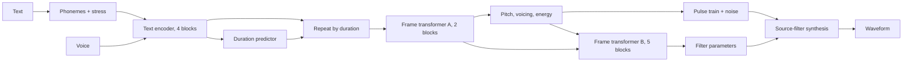

# Model and data

## Model

The text encoder and the two frame-level transformers use pre-norm blocks with
rotary position embeddings (192 channels, 4 heads). Durations, pitch, voicing
and energy are predicted explicitly, as in FastSpeech 2.

The waveform is produced by a source-filter synthesizer instead of a neural
vocoder. A band-limited pulse train at the predicted pitch and a noise signal
are each shaped by a time-varying filter, whose cepstrum the network predicts
once per frame (hop 256 samples, 10.7 ms). This part has 25,862 parameters.

| Component | Parameters |
|---|---:|
| Embeddings (phoneme, stress, voice) | 12,864 |
| Text encoder | 1,588,864 |
| Duration and pause predictor | 123,906 |
| Frame transformer A, prosody head | 795,971 |
| Frame transformer B | 1,985,984 |
| Source-filter waveform head | 25,862 |
| Total at inference | 4,533,451 |

Two modules exist only during training: an auxiliary mel head (15,440
parameters) and the waveform discriminators (2,675,312).

## Text

Text becomes phonemes with eSpeak NG (`es` or `es-419`). The inventory has 56
symbols: 5 special tokens, 14 punctuation marks (including `¿` and `¡`) and 37
phones (26 consonants, 5 vowels, the open `ɛ` and 5 diphthongs). Stress is a
separate feature, not a token. Every phone is also a label of the alignment
model, which was checked against its vocabulary.

## Data

mini-voz has no dataset yet; see the README for the two ways to make one.
The original tiny-voca was trained on 17.6 hours of synthetic speech for two
voices (16,018 clips), generated with Qwen3-TTS and screened with Whisper.

Phoneme durations come from forced alignment with
`facebook/wav2vec2-lv-60-espeak-cv-ft`, a multilingual recogniser. It is used
only to label the training data. The annotation format is described in
[annotations-v3.md](annotations-v3.md).

## Training

Training has two phases: spectral losses only for the first 8,000 steps, then
an added adversarial loss with multi-period and multi-resolution
discriminators. tiny-voca's released checkpoint was trained for 104,737 steps
on one RTX 4090, 7.7 hours in total.

## Evaluation

`mini_voz.evaluate` synthesizes held-out and new sentences from text alone,
transcribes them with multilingual Whisper (`small`, Spanish) and reports the
word error rate next to that of the recordings. There are no results yet.

## Third-party components

eSpeak NG (GPL-3.0, used as an external program for phonemes),
`facebook/wav2vec2-lv-60-espeak-cv-ft` (Apache-2.0, alignment only), Whisper
(MIT, screening and evaluation only) and, for synthetic data, Qwen3-TTS
(Apache-2.0).

mini-voz is a Spanish adaptation of tiny-voca (Apache-2.0) by Muhammed Nazeem.
The design builds on FastSpeech 2, DDSP and the neural homomorphic vocoder,
and HiFi-GAN and UnivNet. No code or weights from these projects are used.
